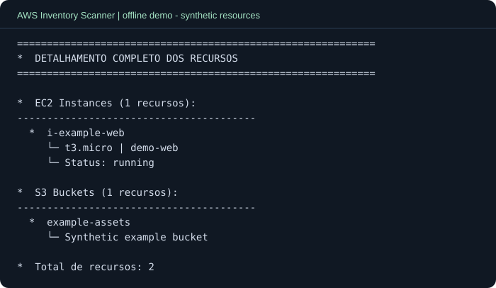

# AWS Inventory Scanner

A Python CLI for discovering AWS resources, exporting an inventory, and comparing scans.



The preview uses the project's actual output renderer with synthetic resource names. It is an offline demonstration, not data from an AWS account.

## What it does

- Discovers resources across services such as EC2, S3, Lambda, RDS, networking, and IAM.
- Prints a summary and resource details.
- Exports JSON, CSV, and HTML reports.
- Compares an inventory with a previously exported JSON file.
- Provides basic checks for potentially unused resources and security-related observations.

Terminal icons in the preview are normalized for portable rendering.

## Installation

Python 3.11 or newer is recommended. Install the dependencies in a virtual environment:

```bash
git clone https://github.com/thomm-011/aws-inventory-scanner.git
cd aws-inventory-scanner
python3 -m venv .venv
source .venv/bin/activate
python -m pip install -r requirements.txt
python aws_inventory_scanner.py --help
python aws_inventory_scanner.py --list-services
```

The activation command above is for macOS/Linux. On Windows PowerShell, use `.venv\Scripts\Activate.ps1`.

## AWS authentication

Configure credentials outside the repository using the standard Boto3 credential chain. For a configured named profile, for example:

```bash
export AWS_PROFILE=portfolio
python aws_inventory_scanner.py --region us-east-1 --summary-only
```

Use an identity authorized for the list/describe operations used by the scanner. Missing service permissions can produce incomplete results. Some services are global even when a region is selected.

## Usage

```bash
# Inventory and all supported export formats
python aws_inventory_scanner.py --region us-east-1 --export-all

# Add the built-in resource analysis
python aws_inventory_scanner.py --region us-east-1 --analyze

# Compare against an existing JSON export; replace the example path
python aws_inventory_scanner.py --region us-east-1 --compare exports/previous.json
```

By default, reports are written to `exports/`. The JSON export contains a timestamp, resource count, and resources grouped by service. Create a custom output directory before passing it with `--output-dir`.

## Current limitations

- The CLI parses `--profile`, `--services`, `--exclude-services`, and `--no-emojis`, but those options are not fully connected to the listing/output implementation. Use `AWS_PROFILE` for named-profile selection; do not rely on the service flags to restrict a scan.
- Checks for unused resources and potential cost issues are heuristics, not billing estimates or a complete security audit.
- A scan reflects the selected region, service APIs, and available permissions. It is not a complete multi-account inventory.
- Exports can contain account and resource information. Review them before sharing.

## Code map

- `aws_inventory_scanner.py`: command-line entry point.
- `listar_recursos.py`: service discovery and console output.
- `utils.py`: export, analysis, and comparison helpers.
- `config.py`: defaults and service configuration.

## Author

[Thomas Silva Cordeiro](https://thomm-011.github.io/) · [LinkedIn](https://www.linkedin.com/in/thomas-s-923082184/)
